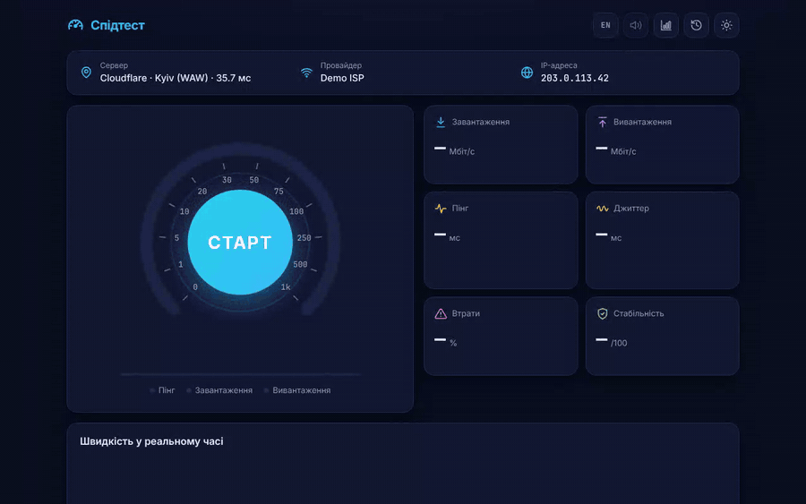
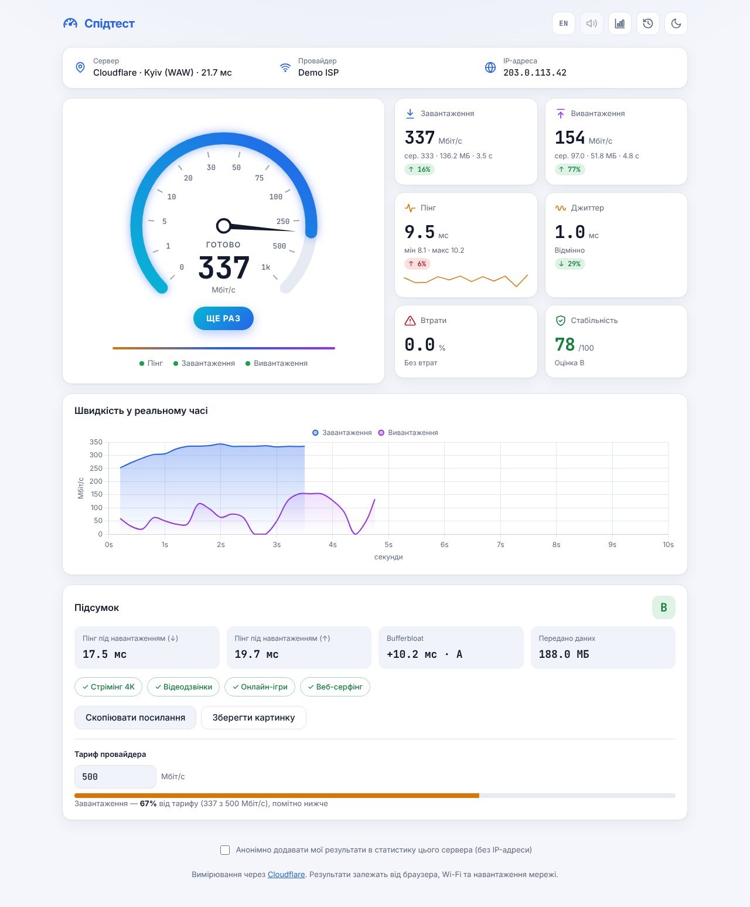
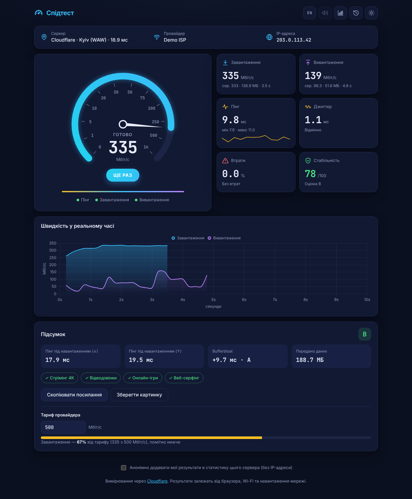
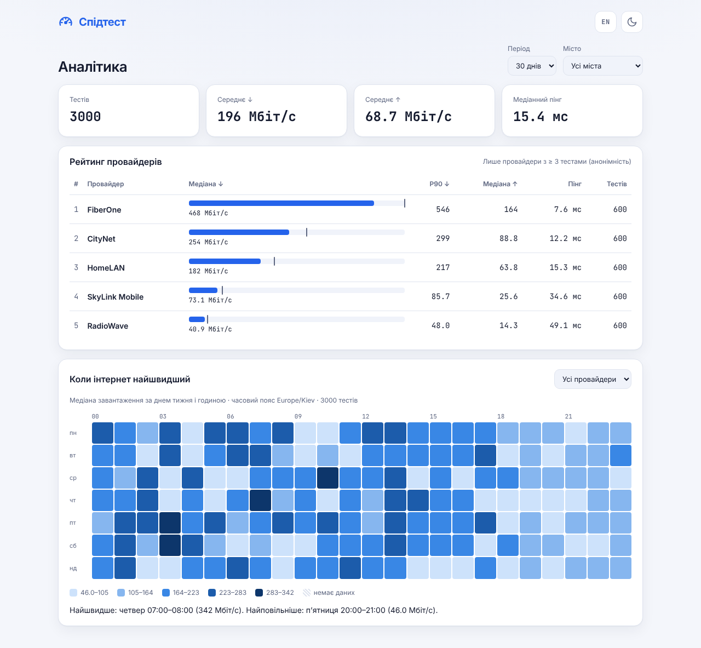
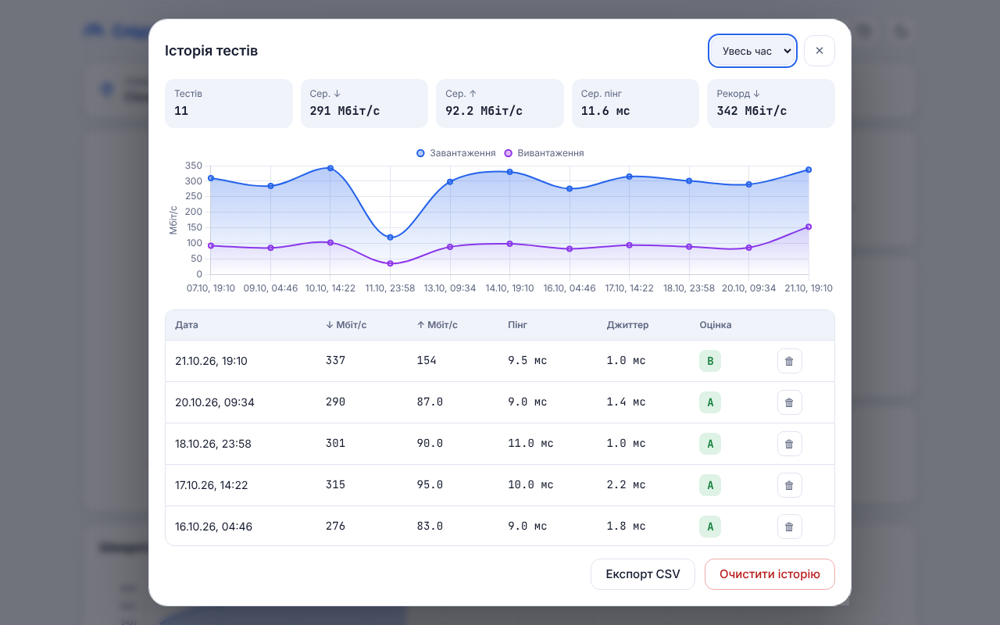
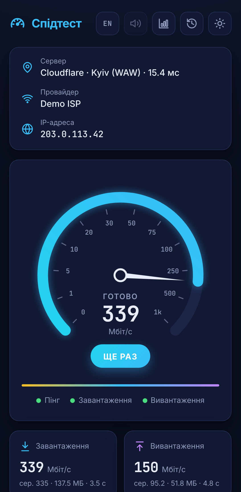
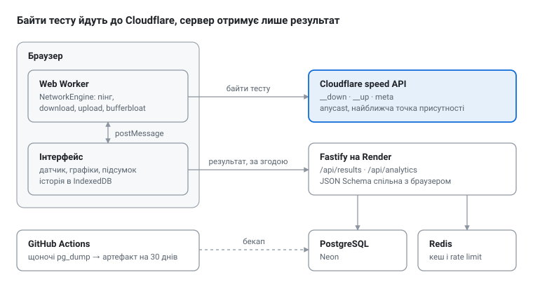

<div align="center">

# Спідтест

**Точний браузерний тест швидкості інтернету на чистому JavaScript**

Пінг · джиттер · втрати · download · upload · bufferbloat · стабільність з'єднання

**Українська** · [English](README.en.md)

[](https://github.com/VMMNick/speedtest/actions/workflows/ci.yml)
[](https://github.com/VMMNick/speedtest/actions/workflows/backup.yml)


[**Відкрити демо**](https://vmmnick.github.io/speedtest/) · [Версія з аналітикою](https://speedtest-v003.onrender.com/analytics.html) (безкоштовний сервер прокидається до хвилини) · [Як це працює](docs/measurement.md) · [Архітектура](docs/architecture.md)



</div>

## Чому цей проєкт цікавий

- **Вимірювання, а не «прогрес-бар».** Швидкість — 90-й перцентиль у ковзному вікні після розгону TCP (як у Cloudflare й Ookla), пінг — із Resource Timing API з відніманням часу сервера (`Server-Timing`), раннє завершення, коли швидкість стабілізувалась (CV ≤ 5%). [Деталі →](docs/measurement.md)
- **Bufferbloat.** Окремо міряється пінг _під навантаженням_ — те, що відчувається в іграх і відеодзвінках, але чого не показують звичайні спідтести.
- **Інтерфейс не фризить навіть на гігабіті.** Увесь рушій працює у Web Worker; Chart.js (~¾ усього JS) вантажиться лише коли знадобиться — стартовий JS ~18 KB gzip, а англійський словник вантажиться лише коли потрібен.
- **Повний стек.** Опційний бекенд на Fastify + PostgreSQL + Redis: анонімна статистика, рейтинг провайдерів і теплова карта «коли інтернет найшвидший» з k-анонімністю та кешем агрегацій.
- **Production-гігієна.** Сувора CSP без `unsafe-inline`, PWA з власним service worker, 2 мови з перемиканням «на льоту», WCAG 2.1 AA (axe), ~200 тестів, CI з 7 джобами й порогами Lighthouse у кожному PR, щоденний бекап бази.

## Скріншоти

| Світла тема                                                   | Темна тема                                                  |
| ------------------------------------------------------------- | ----------------------------------------------------------- |
|  |  |

| Аналітика (демо-дані)                                            | Історія                                               | Мобільний                                                           |
| ---------------------------------------------------------------- | ----------------------------------------------------- | ------------------------------------------------------------------- |
|  |  |  |

> Провайдери на скріншотах вигадані, а «мережа» — локальний сервер з обмеженою швидкістю: зйомку відтворює `npm run media`.

## Можливості

| Що                | Деталі                                                                                                                                       |
| ----------------- | -------------------------------------------------------------------------------------------------------------------------------------------- |
| **Вимірювання**   | пінг, джиттер (RFC 3550), втрати, download/upload у паралельних потоках з адаптивним чанком, bufferbloat (A–F), стабільність 0–100           |
| **Інтерпретація** | придатність для ігор, відеодзвінків і 4K; % від тарифу провайдера; порівняння з попереднім тестом ↑/↓                                        |
| **Історія**       | IndexedDB (фолбек — localStorage), графік, фільтр за періодом, експорт CSV                                                                   |
| **Поділитися**    | посилання з результатом у самому URL (без сервера й без IP), PNG-картка 1200×630, нативне меню на мобільних                                  |
| **Аналітика**     | рейтинг провайдерів (медіана й P90), фільтр за містом, теплова карта день × година у часовому поясі користувача, демо-режим, поки даних мало |
| **Досвід**        | PWA й офлайн, світла/темна тема без блимання, uk/en, клавіатура (`Enter`/`Esc`), `prefers-reduced-motion`, сторінка конфіденційності         |

## Як це влаштовано

<picture>
  <source media="(prefers-color-scheme: dark)" srcset="docs/media/architecture-dark.svg">
  
</picture>

- **`apps/web/src/core`** — чиста логіка вимірювань без DOM (працює у воркері, тестується в Node); **`apps/web/src/services`** — мережа, сховище, PWA; **`apps/web/src/ui`** — усе, що торкається DOM; **`packages/shared`** — JSON Schema результату, спільна для браузера й сервера (`apps/server`). Монорепозиторій на npm workspaces: один `npm install` ставить усе.
- Межі шарів перевіряє ESLint, а контрактний тест проганяє тіло запиту з браузера через справжню валідацію сервера. [Архітектура →](docs/architecture.md)
- API задокументоване в OpenAPI 3.1 зі схем валідації: [Swagger UI](https://speedtest-v003.onrender.com/api/docs) · [`docs/openapi.json`](docs/openapi.json).
- Три режими збірки з одного коду: **GitHub Pages** (лише Cloudflare), **cloud** (Render: Cloudflare + статистика), **selfhosted** (власні ендпоінти вимірювань — для перевірки Wi-Fi у локальній мережі).

## Технології

| Шар            | Стек                                                                                                        |
| -------------- | ----------------------------------------------------------------------------------------------------------- |
| Фронтенд       | Vanilla JS (ES-модулі, JSDoc + `checkJs`), Web Workers, Chart.js, Vite, власні плагіни CSP і service worker |
| Бекенд         | Node.js 22, Fastify 5, PostgreSQL 18 (Neon), Redis, JSON Schema, OpenAPI 3.1 / Swagger UI                   |
| Якість         | Vitest, Playwright (E2E + axe), ESLint, Prettier, TypeScript-перевірка JS                                   |
| Інфраструктура | Docker (multi-stage, non-root), GitHub Actions, GitHub Pages, Render, Dependabot                            |

## Швидкий старт

```bash
npm install
npm run dev          # http://localhost:5173
npm run check        # lint + format + typecheck + юніт-тести
npm run test:e2e     # Playwright (потрібен npx playwright install chromium)
```

Повний стек із базою і Redis:

```bash
docker compose up -d --build   # http://localhost:8080, аналітика — /analytics.html
```

Потрібен Node.js 22.12+. Деплой на Render — одна кнопка (Blueprint `render.yaml`):

[](https://render.com/deploy?repo=https://github.com/VMMNick/speedtest)

## Документація

| Документ                                     | Про що                                                                             |
| -------------------------------------------- | ---------------------------------------------------------------------------------- |
| [Як працює вимірювання](docs/measurement.md) | ендпоінти Cloudflare, P90, Server-Timing, раннє завершення, bufferbloat, обмеження |
| [Архітектура](docs/architecture.md)          | структура папок, правила залежностей між шарами, протокол воркера                  |
| [Сервер і деплой](docs/server.md)            | API, приватність, аналітика, Docker, Render, Neon, бекапи                          |
| [Розробка](docs/development.md)              | команди, бюджет розміру, тести, CI, i18n, PWA, CSP, скріншоти                      |

## Автор

Mykola Vorobkanych ([@VMMNick](https://github.com/VMMNick)) — full-stack розробник.
